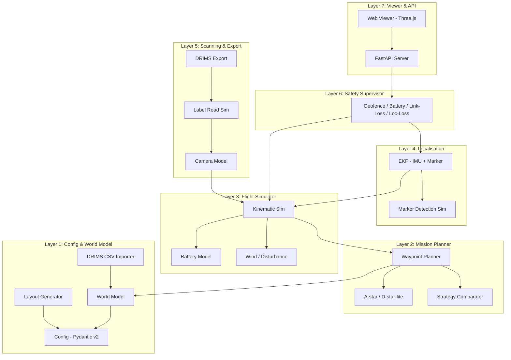
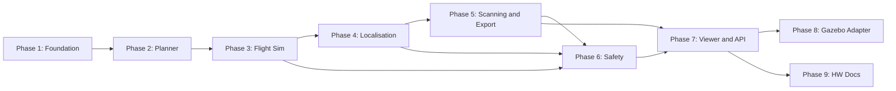

# drone-nav Implementation Plan

> **Status**: AWAITING APPROVAL  
> **Author**: Antigravity Agent  
> **Date**: 2026-10-13  
> **Version**: 1.0

---

## 1. Project Overview

**drone-nav** is a standalone, simulation-only application that plans and simulates indoor warehouse inventory-drone flights, localises the drone via marker+IMU fusion, scans bin labels, and exports mission data in the DRIMS ingestion schema.

- **Not** a real-drone controller — all dynamics are kinematic simulation.
- **Not** part of DRIMS — integration is via a data contract (JSON Schema) only.
- **Configurable** — every warehouse dimension, drone parameter, noise value, and threshold comes from validated config files.

### Key Constraints

| Constraint | Detail |
|---|---|
| Host OS | Windows (WSL2 Docker backend) |
| Core dependency | Pure Python 3.12, no ROS/Gazebo/GPU required |
| Determinism | Seeded RNGs everywhere; same seed → identical output |
| Config-driven | Zero hardcoded warehouse/drone/noise values |
| Licence compliance | Every asset recorded in `THIRD_PARTY.md` |

---

## 2. Architecture

```
drone-nav/
├── docs/                    # PLAN.md, ADRs, config reference, architecture diagram
├── configs/                 # Preset configs + JSON Schema
│   ├── schema/              # JSON Schema files for config validation
│   ├── presets/             # small.yaml, medium.yaml, large.yaml
│   └── examples/           # Example DRIMS CSV, custom configs
├── src/
│   └── drone_nav/
│       ├── __init__.py
│       ├── cli.py           # Typer CLI entry point
│       ├── config/          # Layer 1: Pydantic v2 models, loaders, validators
│       ├── world/           # Layer 1: World model, layout generator, importers
│       ├── planner/         # Layer 2: Mission planner, A*/D*-lite, strategies
│       ├── simulator/       # Layer 3: Kinematic flight sim, battery, wind
│       ├── localisation/    # Layer 4: EKF, marker detection, IMU fusion
│       ├── scanning/        # Layer 5 (part): Camera model, label reads
│       ├── export/          # Layer 5 (part): DRIMS schema export
│       ├── safety/          # Layer 6: Geofence, battery, link/loc loss
│       ├── api/             # Layer 7: FastAPI server
│       ├── viewer/          # Layer 7: Web UI (HTML/JS/Three.js)
│       └── adapters/        # Layer 8: Optional Gazebo/PX4/ROS 2 bridge
├── tests/
│   ├── unit/
│   ├── integration/
│   └── conftest.py
├── docker/
│   ├── Dockerfile
│   └── docker-compose.yml
├── .github/
│   └── workflows/
│       └── ci.yml
├── pyproject.toml
├── README.md
├── LICENSE
├── THIRD_PARTY.md
└── .gitignore
```

### Layer Diagram



---

## 3. Tech Stack

| Component | Library | Version | Purpose |
|---|---|---|---|
| Language | Python | 3.12 | Core runtime |
| Config validation | pydantic | v2.x | Typed config models with JSON Schema export |
| Numerics | numpy, scipy | latest | Kinematics, EKF, statistics |
| Graph/planning | networkx | latest | A*/D*-lite path planning |
| Geometry | shapely | latest | 2D geofence, zone checks, bin geometry |
| CLI | typer | latest | Command-line interface |
| API | fastapi, uvicorn | latest | REST API + WebSocket |
| Testing | pytest, pytest-cov, hypothesis | latest | Unit/property tests, coverage |
| Linting | ruff, mypy | latest | Code quality |
| Config format | PyYAML | latest | YAML config loading |
| Viewer | Three.js (CDN) | r160+ | 3D warehouse visualisation |
| Container | Docker, docker-compose | latest | Reproducible environment |
| Optional | PX4, MAVSDK, apriltag | -- | Adapter layer only |

---

## 4. Configuration Design

### 4.1 Schema Approach

- **Source of truth**: Pydantic v2 models in `src/drone_nav/config/models.py`
- **JSON Schema**: Auto-exported from Pydantic models (`model_json_schema()`)
- **Config files**: YAML (primary) with JSON fallback
- **Validation**: On load via Pydantic; CLI `validate` command; clear error messages with field paths

### 4.2 Config Sections

| Section | Key Fields | Notes |
|---|---|---|
| `site` | id, name, units, coordinate_frame (origin, axes, z-up), floor_bounds, ceiling_height, timezone | All lengths in metres |
| `layout` | zones, aisles (pos, length, width, one_way), racks (bays, levels, bay_width, level_heights, depth, bin_width, bin_height), bin_numbering_template, doors, charging_stations, pads, no_fly_zones, people_zones | Bin template: `WH{site_id}-{zone}{aisle:02d}-R{rack:02d}-L{level}-B{bay:02d}` |
| `obstacles` | static (pallets, pillars, blocked_aisles), dynamic (walkers, forklifts with path/speed/schedule), random_seed | Seeded generator for random obstacles |
| `drone` | mass, max_speed, max_accel, max_yaw_rate, battery (capacity_wh, discharge model with hover/forward/climb costs, safe_reserve_pct), camera (resolution, fov, mount_angle, standoff_distance, exposure_time), sensors (imu_bias, imu_noise, marker_noise, marker_miss_prob) | Discharge model: power = f(state) x dt |
| `localisation` | marker_size, marker_spacing_rule, pose_noise, drift_model, ekf_params (process_noise Q, measurement_noise R) | Markers at rack ends + every N bays |
| `mission` | target (zone_list or bin_list), priority, scan_strategy (serpentine/nearest/minimum_time), max_flight_duration, return_to_charge_rules | Strategy is selectable + comparable |
| `safety` | min_rack_clearance, geofence_margin, battery_reserve, link_loss_action, localisation_loss_action | Actions: hover_then_land, return_home, emergency_stop |
| `export` | drims_endpoint_url, auth, site_id_mapping, schema_version, mode (dry_run/file/api) | File mode writes JSON; API mode posts if reachable |

### 4.3 Presets

| Preset | Aisles | Racks/Aisle | Bays | Levels | Total Bins | Warehouse Size |
|---|---|---|---|---|---|---|
| **small** | 3 | 2 | 5 | 3 | ~90 | 15m x 10m |
| **medium** | 8 | 2 | 8 | 4 | ~500 | 40m x 25m |
| **large** | 20 | 2 | 16 | 4 | ~5,000 | 100m x 60m |

### 4.4 Importers

1. **DRIMS Location CSV**: Columns `site_id, zone, aisle, rack, level, bin, label_code, x_min, x_max, y_min, y_max, z_min, z_max`. Builds world model from coordinates.
2. **Layout generator**: From compact `layout` config, generates full rack/bin geometry with coordinates.
3. **SDF/Gazebo importer** (optional): Reads an SDF world for visual use in the adapter layer.

---

## 5. Phase Plan

### Phase 1: Foundation and World Model
**Duration estimate**: 1 session  
**Depends on**: Nothing

#### Deliverables
- Git repo with `.gitignore`, `LICENSE` (MIT), `THIRD_PARTY.md`
- `pyproject.toml` with all dependencies
- Docker setup (`Dockerfile`, `docker-compose.yml`)
- CI workflow (`.github/workflows/ci.yml`)
- Pydantic v2 config models for all sections
- JSON Schema export from models
- 3 preset configs (`small.yaml`, `medium.yaml`, `large.yaml`)
- Layout generator: config to world model with computed bin coordinates
- DRIMS CSV importer
- Typer CLI with `validate`, `generate-layout`, `import-csv` commands
- Viewer v0: FastAPI serving static HTML/JS top-down map
- Unit tests (>=80% coverage on config + world modules)

#### Exit Criteria
| Criterion | How to verify |
|---|---|
| `validate` passes on all 3 presets | `drone-nav validate configs/presets/small.yaml` (x3) |
| Layout stats printed | Bins, racks, aisles count logged |
| Invalid config rejected with clear message | Test with missing/wrong fields |
| Viewer shows map | Screenshot of each preset |
| Tests pass with >=80% coverage | `pytest --cov` output |

---

### Phase 2: Mission Planner
**Duration estimate**: 1 session  
**Depends on**: Phase 1

#### Deliverables
- Navigation graph built from world model (aisle-level, with one-way edges)
- A* path planner on the navigation graph
- Scan pose calculator (standoff distance, camera aim vector per bin)
- Waypoint sequencer with scan-order strategies: serpentine, nearest-neighbour, minimum-time
- Battery-aware flight splitting (return-to-charge when reserve threshold hit)
- One-way aisle enforcement
- No-fly zone avoidance
- Strategy comparator (table output)
- Path plot export (matplotlib or viewer overlay)
- Unit + edge-case tests

#### Exit Criteria
| Criterion | How to verify |
|---|---|
| 500-bin plan generated | `drone-nav plan configs/presets/medium.yaml` |
| Coverage %, flights, path length, duration reported | Terminal output |
| Strategy comparison table | Terminal output for serpentine vs nearest vs minimum-time |
| Edge cases pass | blocked aisle, unreachable bin, tiny battery, no-fly zone tests |
| Path plot | Screenshot |

---

### Phase 3: Flight Simulation
**Duration estimate**: 1 session  
**Depends on**: Phase 2

#### Deliverables
- Kinematic simulator: state = (pos, vel, attitude, battery, time)
- Dynamics model with configurable max speed/accel/yaw rate
- Battery discharge model (hover/forward/climb cost rates)
- Wind/disturbance model (configurable, seeded)
- Trajectory tracking controller (PID or similar)
- Telemetry log output (JSON Lines: timestamp, pos, vel, attitude, battery)
- Deterministic seed producing identical replay
- Planned vs flown path comparison
- Tracking error statistics
- Unit tests

#### Exit Criteria
| Criterion | How to verify |
|---|---|
| Planned vs flown path overlay plot | Screenshot |
| Tracking error stats (mean, p95, max) | Terminal output |
| Battery curve plot | Screenshot |
| Reproducibility (same seed = identical log) | Hash comparison test |
| Tests pass | `pytest` output |

---

### Phase 4: Localisation - Marker + IMU Fusion
**Duration estimate**: 1 session  
**Depends on**: Phase 3

#### Deliverables
- Marker placement generator (from layout config: rack ends + every N bays)
- Simulated marker detection (noise, occlusion, miss rate from config)
- IMU dead-reckoning model (bias + noise from config)
- Extended Kalman Filter fusing IMU + marker fixes
- Drift growth analysis between markers
- Position error vs ground truth statistics
- Marker spacing sweep (vary N, report error)
- Failure case: long marker gap
- Unit tests

#### Exit Criteria
| Criterion | How to verify |
|---|---|
| Error stats (mean, p95, max) over full mission | Terminal output |
| Marker spacing sweep table | N=1,2,4,8 with error stats |
| Long-gap failure case documented | Terminal output showing drift |
| Expected DRIMS telemetry error reported | Documented in report |
| Tests pass | `pytest` output |

---

### Phase 5: Scanning and DRIMS Export
**Duration estimate**: 1 session  
**Depends on**: Phase 4

#### Deliverables
- Camera model: bins in view based on position, FOV, mount angle; image quality model (distance, angle, motion blur)
- Label read simulation: success probability = f(quality), confidence value, readType, symbology
- Coverage tracker (per bin: visited, scanned, read_success)
- DRIMS v1 export schema (Pydantic model + JSON Schema):
  - `mission.json`: missionId, droneId, startTime, endTime, config snapshot
  - `scans.json`: array of scan events (schemaVersion, missionId, eventId UUID, droneId, timestamp_utc, readType, symbology, value, confidence, locationTag, position, imageRef, bbox)
  - `telemetry.json`: sampled telemetry
  - `/complete` marker
- Export modes: JSON files (always), API post (if endpoint reachable, else NOT STARTED)
- `ground_truth.json`: true bin visits, true positions, injected failures
- Idempotency: re-export produces same eventIds (seeded UUIDs)
- Unit tests

#### Exit Criteria
| Criterion | How to verify |
|---|---|
| Full mission exported | File listing + sample payload |
| JSON Schema validation passes | jsonschema CLI or test |
| Coverage and read-rate stats | Terminal output |
| Idempotency test | Hash comparison |
| Tests pass | `pytest` output |

---

### Phase 6: Obstacle Avoidance and Safety
**Duration estimate**: 1 session  
**Depends on**: Phases 3, 4, 5

#### Deliverables
- Static obstacle avoidance (blocked aisles, pallets, pillars) with replanning
- Dynamic obstacle avoidance (walkers, forklifts) with replanning
- Speed limits in people zones
- Minimum rack clearance enforcement
- Geofence enforcement
- Battery return-to-charge trigger
- Low-battery emergency landing
- Link loss protocol (hover then return or land)
- Localisation loss protocol (hover then land)
- Emergency stop
- Safe state on software crash (simulated)
- Failure injection framework for testing
- Unit tests

#### Exit Criteria
| Criterion | How to verify |
|---|---|
| Failure injection table (11 scenarios) | All pass/fail with logs |
| Each safety behaviour demonstrated | Logs or viewer screenshots |
| Replanning on blocked aisle shown | Before/after path |
| Tests pass | `pytest` output |

---

### Phase 7: Viewer, API, and Scenario Runner
**Duration estimate**: 1 session  
**Depends on**: Phases 1-6

#### Deliverables
- FastAPI endpoints: config CRUD, mission run, replay data, scan inspection, run comparison, export download
- Web UI pages:
  - Config editor (preset selection, parameter editing)
  - Mission runner (start, progress, stop)
  - 2D top-down replay (canvas)
  - 3D replay (Three.js)
  - Scan inspector (per-bin results)
  - Run comparator
- Scenario runner CLI: batch experiments with parameter sweeps
- Results table + plots for sweeps
- API test suite
- Unit tests

#### Exit Criteria
| Criterion | How to verify |
|---|---|
| All UI screens shown | Screenshots |
| API test suite passes | `pytest` output |
| Batch sweep with results table | Terminal output + plot |
| Tests pass | `pytest` output |

---

### Phase 8: Optional Gazebo/PX4/ROS 2 Adapter
**Duration estimate**: 1 session (if environment supports it)  
**Depends on**: Phase 7  
**Status**: Will attempt; may be NOT STARTED if host cannot run PX4 SITL

#### Deliverables (if feasible)
- SDF world generator from drone-nav config (racks as boxes, markers as textures)
- PX4 SITL launch script (headless)
- MAVSDK flight controller using the same mission plan
- ULog/rosbag recording
- Trajectory comparison: kinematic sim vs PX4 SITL

#### Exit Criteria
| Criterion | How to verify |
|---|---|
| SDF world generated | File exists |
| PX4 SITL runs | Terminal output |
| Mission flown | Trajectory log |
| Comparison plot | Screenshot |
| If blocked: exact error documented | Report |

---

### Phase 9: Hardware Readiness - Documents Only
**Duration estimate**: 1 session  
**Depends on**: Phase 7  
**Status**: Documents only, no hardware

#### Deliverables
- Bill of Materials (BOM) options document
- Companion computer integration plan
- Sensor calibration procedures
- Bring-up checklist (bench to hand-carried to tethered to free flight)
- Safety and regulatory checklist (note: local rules must be checked; no legal conclusions)

#### Exit Criteria
| Criterion | How to verify |
|---|---|
| All 5 documents written | File listing |
| No claims of real-drone behaviour | Review |

---

## 6. Quality Gates (All Phases)

| Gate | Requirement |
|---|---|
| Test coverage | >= 80% on planner, simulator, localisation, export |
| Linting | `ruff check` clean |
| Type checking | `mypy --strict` on core modules |
| Determinism | Same seed produces identical output (tested) |
| Config validation | Every load validates; invalid configs produce clear errors |
| Git hygiene | Commit after every phase; `.gitignore` for data/secrets/caches |
| Documentation | README, config reference, architecture diagram, data contract, ADRs |
| Licence compliance | `THIRD_PARTY.md` with every dependency's licence + URL |

---

## 7. Key Architecture Decision Records (ADRs)

### ADR-001: Pure Python Core (No ROS/Gazebo Dependency)
**Decision**: Core layers 1-6 use only Python + NumPy/SciPy. ROS 2, Gazebo, and PX4 are isolated in `/adapters/`.  
**Rationale**: Windows host, no GPU guarantee, faster development iteration. The adapter layer shares the same config and mission format, so parity is maintained.

### ADR-002: Pydantic v2 as Single Source of Truth for Config
**Decision**: All config is defined as Pydantic v2 models. JSON Schema is auto-exported.  
**Rationale**: Type safety, validation, serialisation, and schema generation from one place. Eliminates schema drift.

### ADR-003: Kinematic (Not Physics) Simulator
**Decision**: Flight dynamics are first-order kinematics with configurable limits, not a full rigid-body physics engine.  
**Rationale**: Sufficient for warehouse-scale planning and scan simulation. Real physics come from PX4 SITL in the adapter.

### ADR-004: Deterministic Simulation with Seeded RNG
**Decision**: Every stochastic element (noise, wind, marker miss, obstacle placement) uses a seeded RNG.  
**Rationale**: Reproducibility is essential for testing, comparison, and debugging.

### ADR-005: DRIMS Data Contract as JSON Schema
**Decision**: Integration with DRIMS is via a versioned JSON Schema, not an API dependency.  
**Rationale**: DRIMS is a separate project. The schema is the contract. Export validates against it. Live API posting is optional.

---

## 8. Data Contract: DRIMS v1 Ingestion Schema

### Scan Event

```json
{
  "schemaVersion": "1.0",
  "missionId": "uuid",
  "eventId": "uuid",
  "droneId": "string",
  "timestamp": "ISO 8601 UTC",
  "readType": "BARCODE | QR | RFID | IMAGE_COUNT",
  "symbology": "string (e.g. CODE128, QRCODE)",
  "value": "string (label value)",
  "confidence": 0.95,
  "locationTag": "WH01-A12-R03-L2-B04",
  "position": {
    "x": 12.5,
    "y": 3.2,
    "z": 2.1,
    "frame": "warehouse_origin"
  },
  "imageRef": "path or null",
  "bbox": { "x": 100, "y": 200, "w": 50, "h": 30 }
}
```

### Mission Summary

```json
{
  "schemaVersion": "1.0",
  "missionId": "uuid",
  "droneId": "string",
  "siteId": "string",
  "startTime": "ISO 8601 UTC",
  "endTime": "ISO 8601 UTC",
  "totalFlights": 3,
  "binsScanned": 487,
  "binsTotal": 500,
  "coveragePct": 97.4,
  "readSuccessRate": 0.94,
  "configSnapshot": {}
}
```

---

## 9. Risk Register

| Risk | Impact | Mitigation |
|---|---|---|
| PX4 SITL won't run on Windows/WSL2 | Phase 8 blocked | Isolated in adapter; mark NOT STARTED with exact error |
| Three.js 3D viewer performance on large warehouse | Slow rendering | LOD, instanced meshes, fallback to 2D |
| EKF tuning sensitivity | Poor localisation | Parameter sweep in Phase 4; config-driven Q/R matrices |
| DRIMS schema changes | Export breaks | Versioned schema; adapter pattern for future versions |
| Test coverage hard to reach 80% on viewer | Low coverage | Exclude viewer from coverage gate; test API separately |

---

## 10. Dependency Graph



---

## Approval Request

> **Please review this plan and confirm approval to begin Phase 1.**
>
> Key questions for your consideration:
> 1. Are the 3 preset sizes (90 / 500 / 5000 bins) appropriate for your use case?
> 2. Is the DRIMS v1 scan event schema structure acceptable as the data contract?
> 3. Any config sections you want to add or modify?
> 4. Should Phase 8 (Gazebo/PX4) be attempted or explicitly deferred?
